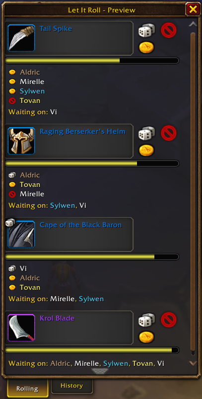

# Let It Roll

A better Need/Greed window for **World of Warcraft: Forever**. Roll on every item in one place, see each player's pick live, and keep a history of who won. Built entirely from Blizzard's own UI.



## Features

- **Rolling:** every item up for a roll, with Need/Greed/Pass, a timer, each player's pick as it happens and who is still deciding.
- **History:** the winner, roll type and number for every group roll. Saved until you clear it.
- **Can't-use warning:** an icon when a player Needs an item their class can't use.
- **Preview:** sample rolls with a made-up group, to try the window without a group.

## Install

Copy the `LetItRoll` folder to `World of Warcraft/_forever_/Interface/AddOns/`.

## Usage

| Command | |
| --- | --- |
| `/lir` | Open or close the window |
| `/lir history` | Open the History tab |
| `/lir preview` | Start or stop the preview |
| `/lir options` | Open the settings |
| `/lir debug` | Print roll data diagnostics |

The window also opens from the AddOns menu by the minimap, and by itself when a roll starts. The minimap button opens the History tab (right-click for settings, drag to move it).

Settings are under **Options → AddOns → Let It Roll**:

- **Replace the default roll popups** (on by default)
- **Open when a roll starts** (on by default)
- **Show minimap button** (on by default)

## Development

Link the addon into the game instead of copying it, then `/reload` after each change:

```sh
ln -s "$PWD/LetItRoll" "<WoW>/_forever_/Interface/AddOns/LetItRoll"
```

`.luarc.json` points the Lua language server at Blizzard's UI code, exported from the client with `exportInterfaceFiles code` (launch with `-console`). Update the path in it to match your install.

## License

[GPL-3.0-or-later](LICENSE)
